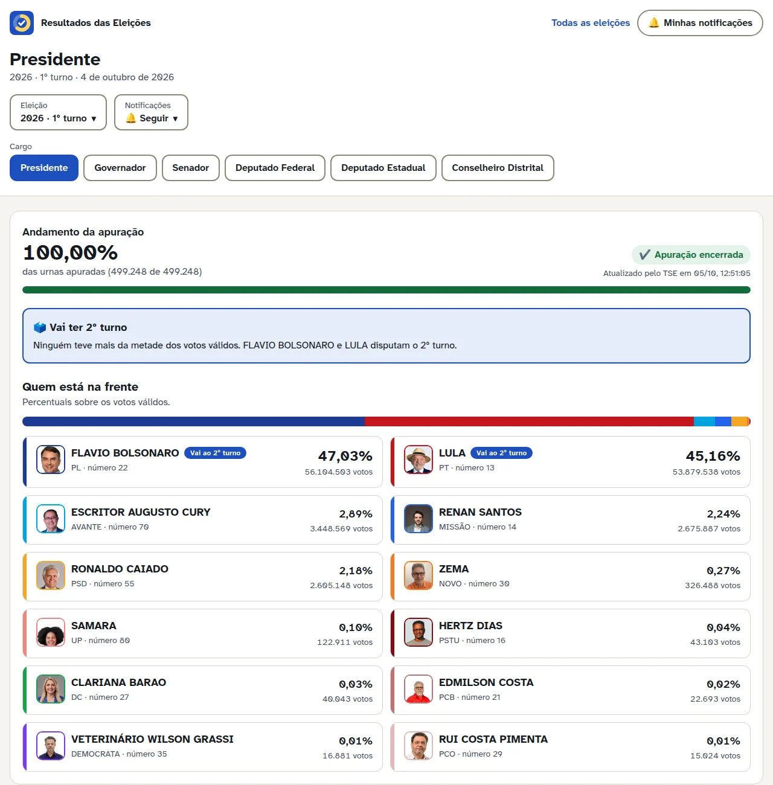
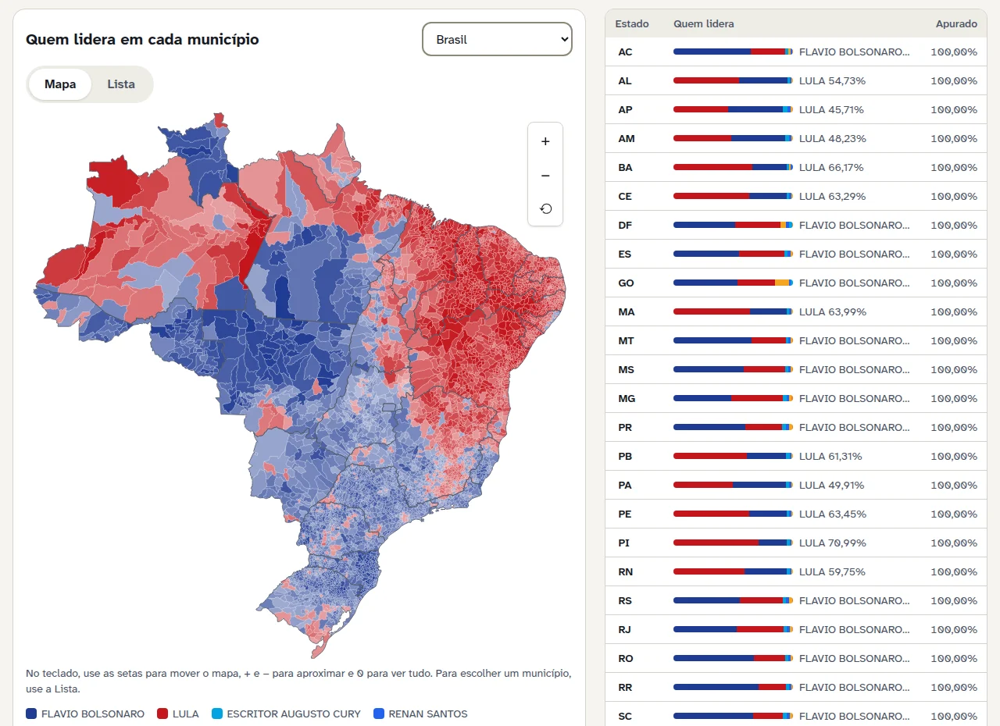
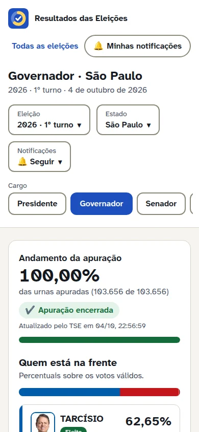
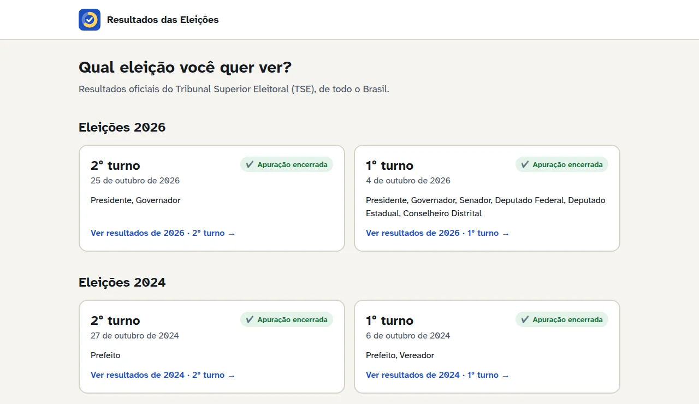
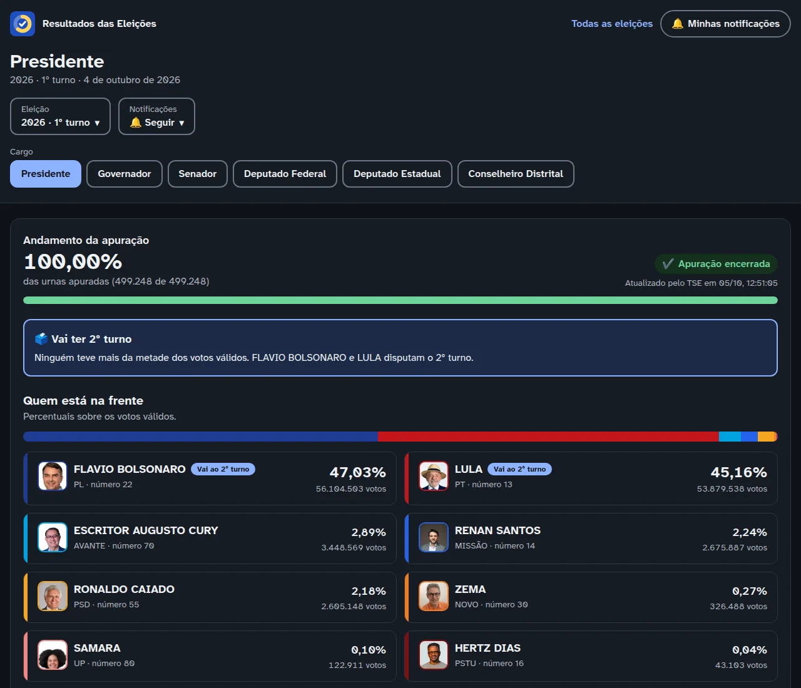
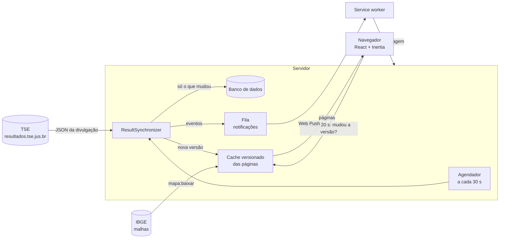

<div align="center">


# Resultados das Eleições

**Apuração das eleições brasileiras em tempo real, com os dados oficiais do TSE.**

Presidente, governador, senador, deputados, prefeito e vereador, do país
inteiro até cada um dos 5.570 municípios, num site rápido, acessível e
pensado para o público geral.

[](https://github.com/vinicgobbi/resultado/actions/workflows/tests.yml)


[**Ver o site no ar →**](https://resultado.vinicgobbi.dev.br)

</div>

<br>



## Sumário

- [Visão geral](#visão-geral)
- [Funcionalidades](#funcionalidades)
- [Como funciona](#como-funciona)
- [Decisões técnicas](#decisões-técnicas)
- [Tecnologias](#tecnologias)
- [Rodando localmente](#rodando-localmente)
- [Comandos](#comandos)
- [Qualidade e testes](#qualidade-e-testes)
- [Deploy](#deploy)
- [Fonte dos dados](#fonte-dos-dados)

## Visão geral

Na noite da eleição, o site oficial do TSE publica os números da apuração
em arquivos JSON que mudam a cada minuto. Este projeto acompanha essa
divulgação, guarda cada resultado e transforma os números em respostas
simples: **quem está na frente, quanto falta apurar, se já existe um eleito
e se vai ter 2º turno.**

Os resultados podem ser acompanhados por cargo e por lugar, com um mapa de
quem lidera em cada município, notificações push sobre os resultados que a
pessoa segue e o arquivo das eleições passadas, desde que o TSE ainda as
publique.

<table>
  <tr>
    <td width="68%"></td>
    <td width="32%"></td>
  </tr>
  <tr>
    <td align="center"><sub>Quem lidera em cada um dos 5.570 municípios</sub></td>
    <td align="center"><sub>Pensado primeiro para o celular</sub></td>
  </tr>
</table>

## Funcionalidades

### Resultados

- **Todos os cargos:** presidente, governador, senador, deputado federal,
  estadual e distrital, prefeito e vereador, em todos os níveis (Brasil,
  estado e município).
- **Ao vivo:** a apuração é sincronizada a cada 30 segundos e a página se
  atualiza sozinha, sem recarregar.
- **Eleito e 2º turno antes do anúncio oficial:** o site identifica quando um
  resultado já é **matematicamente definido** (o líder não pode mais ser
  alcançado, ou ninguém consegue mais passar da metade dos votos válidos) e
  quem já tem vaga garantida no 2º turno.
- **Linguagem simples:** "urnas apuradas", "quem votou e como" e uma seção
  "Como entender este resultado" explicam votos válidos, brancos, nulos,
  abstenção, segundo turno e a divisão de vagas proporcionais.
- **Arquivo:** as eleições passadas ficam disponíveis, agrupadas por dia e
  turno.

### Mapa

- Mapa em SVG com os 5.570 municípios, colorido pelo candidato que lidera e
  com intensidade proporcional à vantagem.
- Zoom e arraste com mouse, toque (pinça) e teclado, com voo animado até o
  estado escolhido.
- Uma **visão em lista**, com busca, que mostra a mesma informação para quem
  não enxerga as cores ou usa leitor de tela.

### Notificações

- O visitante **segue** um cargo num lugar ("Governador · São Paulo") e
  escolhe o que quer receber: atualizações do TSE (no máximo a cada 10
  minutos), resultado matematicamente definido e resultado final.
- O que ele segue vale entre turnos; uma notificação confirma cada novo
  acompanhamento.
- Funciona como PWA: o site pode ser instalado no celular.

### Painel administrativo

- **Situação agora:** bloqueio do TSE (HTTP 429) e quando ele volta, fila de
  tarefas e falhas, mapa gerado e notificações configuradas.
- **Andamento de cada eleição:** resultados finais e última sincronização.
- **Tarefas sem terminal:** sincronizar, importar eleições, baixar fotos dos
  candidatos, gerar o mapa e limpar o cache, acompanhando a saída do comando
  ao vivo.
- Cores dos candidatos e gestão de usuários.

### Acessibilidade e experiência

- Contraste mínimo de 4,5:1 (WCAG AA) em todos os textos, nos temas claro e
  escuro.
- Fonte [Atkinson Hyperlegible Next](https://www.brailleinstitute.org/freefont/),
  criada para leitura com baixa visão.
- Navegação completa pelo teclado, foco sempre visível, link "pular para o
  conteúdo", anúncios ao leitor de tela quando os números mudam.
- Animações suaves (transições de página, números que deslizam, voo do mapa),
  todas desligadas para quem pede menos movimento no sistema.

<table>
  <tr>
    <td width="50%"></td>
    <td width="50%"></td>
  </tr>
  <tr>
    <td align="center"><sub>Escolha da eleição</sub></td>
    <td align="center"><sub>Tema escuro, que segue o sistema</sub></td>
  </tr>
</table>

## Como funciona



1. **Sincronização.** Durante a apuração, o agendador roda
   `tse:sincronizar` a cada 30 segundos. O sincronizador lê o resultado
   nacional e o de cada estado e, para os municípios, consulta o arquivo de
   andamento do TSE e baixa **só os que mudaram desde a última vez**.
2. **Gravação seletiva.** Cada resultado é comparado com o já gravado;
   candidatos e resultados que não mudaram não são escritos de novo.
3. **Cache versionado.** Quando algo muda, as páginas mais acessadas são
   calculadas de antemão sob uma versão nova, e só então os leitores passam
   para ela. Ninguém vê uma página pela metade, e o banco não é consultado
   a cada visita.
4. **Atualização na tela.** A página pergunta a cada 20 segundos apenas qual
   é a versão atual (alguns bytes). Só quando ela muda os resultados são
   baixados de novo, e o mapa, mais pesado, chega depois do conteúdo
   principal.
5. **Notificações.** A sincronização compara o antes e o depois dos
   resultados que alguém segue e gera eventos (nova atualização, resultado
   definido, resultado final). Uma fila monta a mensagem de cada seguidor e
   acorda o navegador com um push; o service worker então busca a mensagem.

## Decisões técnicas

Alguns problemas que exigiram mais cuidado:

| Problema                                                                 | Solução                                                                                                                                                                                                                                               |
| ------------------------------------------------------------------------ | ----------------------------------------------------------------------------------------------------------------------------------------------------------------------------------------------------------------------------------------------------- |
| O TSE bloqueia com **HTTP 429** quem pede demais.                        | Todos os pedidos passam por um cliente com concorrência limitada. Ao primeiro 429, todo pedido ao TSE pausa de forma coordenada, com pausas mais longas se o bloqueio se repete. Tarefas longas param e retomam de onde estavam.                      |
| São **milhares de municípios** por cargo, atualizando o tempo todo.      | Sincronização incremental pelo arquivo de andamento e gravação só do que mudou; uma eleição já concluída não é baixada de novo.                                                                                                                       |
| **"Matematicamente eleito"** e **2º turno garantido** sem esperar o TSE. | Cálculo conservador: supõe que todos os eleitores que faltam votam do pior jeito possível para quem lidera. Um candidato tem vaga garantida no 2º turno quando os dois rivais mais próximos não conseguem ultrapassá-lo juntos.                       |
| Muita gente abrindo a página na mesma hora.                              | Cache versionado e pré-aquecido: as páginas são calculadas uma vez por mudança de dados, não uma vez por visitante.                                                                                                                                   |
| **Mapa com 5.570 polígonos** fluido no celular.                          | Geometria gerada a partir da malha do IBGE e simplificada em caminhos SVG compactos, servida com ETag e guardada pelo service worker. Durante zoom e voo, só uma transformação CSS acelerada pela GPU muda; o desenho é refeito uma única vez no fim. |
| **Notificações sem biblioteca** de Web Push.                             | Assinatura VAPID (ES256) implementada com OpenSSL. O push vai sem conteúdo, e o service worker busca a mensagem do seu navegador, o que dispensa a criptografia do conteúdo.                                                                          |
| Tarefas do painel que levam **horas** (fotos de 450 mil candidatos).     | Fila própria, com worker separado e prazos compatíveis, para nunca atrasar as notificações; a saída do comando é gravada enquanto roda. Uma trava impede que a sincronização manual e a agendada rodem juntas.                                        |

## Tecnologias

| Camada              | Tecnologia                                                                                                                                               |
| ------------------- | -------------------------------------------------------------------------------------------------------------------------------------------------------- |
| Backend             | [PHP 8.5](https://www.php.net/), [Laravel 13](https://laravel.com/)                                                                                      |
| Frontend            | [React 19](https://react.dev/) com [React Compiler](https://react.dev/learn/react-compiler), [TypeScript](https://www.typescriptlang.org/)               |
| Ponte entre os dois | [Inertia.js 3](https://inertiajs.com/) (props adiadas, polling, view transitions) e [Wayfinder](https://github.com/laravel/wayfinder) para rotas tipadas |
| Estilo              | [Tailwind CSS 4](https://tailwindcss.com/) com tokens de cor semânticos                                                                                  |
| Build               | Vite+ (Vite, Rolldown, lint e formatação)                                                                                                                |
| Dados               | SQLite ou MySQL, cache e fila no banco                                                                                                                   |
| Tempo real          | Agendador do Laravel, filas, Web Push (VAPID), service worker e PWA                                                                                      |
| Testes e qualidade  | [Pest 5](https://pestphp.com/), [Larastan/PHPStan](https://github.com/larastan/larastan), [Pint](https://laravel.com/docs/pint), `tsc`                   |
| CI/CD               | GitHub Actions                                                                                                                                           |

## Rodando localmente

**Requisitos:** PHP 8.5, Composer, Node.js 22+ e pnpm.

```bash
git clone https://github.com/vinicgobbi/resultado.git
cd resultado

# Dependências, .env, chave da aplicação, banco e build do frontend
composer setup

# Servidor, Vite, agendador, fila e logs, tudo junto
composer run dev
```

Com o site no ar, carregue os dados:

```bash
php artisan tse:descobrir          # cadastra as eleições publicadas pelo TSE
php artisan mapa:baixar            # gera a geometria do mapa a partir do IBGE
php artisan tse:importar           # importa as eleições já encerradas
php artisan usuarios:criar         # cria um usuário para o /admin
```

Para as notificações push, gere as chaves VAPID e coloque-as no `.env`:

```bash
php artisan push:gerar-chaves
```

> [!NOTE]
> As eleições em apuração são sincronizadas pelo agendador, que o
> `composer run dev` já inicia. Fora do período de apuração, o
> `tse:sincronizar` não tem o que baixar.

## Comandos

| Comando                   | O que faz                                                              |
| ------------------------- | ---------------------------------------------------------------------- |
| `tse:descobrir`           | Cadastra as eleições publicadas no índice do TSE                       |
| `tse:sincronizar`         | Sincroniza as eleições em apuração (`--eleicao`, `--completo`)         |
| `tse:importar`            | Importa as eleições já encerradas (`--revisar` busca retotalizações)   |
| `tse:baixar-base`         | Descobre e baixa todas as eleições que o TSE ainda publica             |
| `tse:fotos`               | Baixa as fotos dos candidatos (`--encerradas`, `--eleicao`, `--cargo`) |
| `mapa:baixar`             | Gera a geometria do mapa a partir da malha do IBGE                     |
| `resultados:limpar-cache` | Faz as páginas de resultados serem calculadas de novo                  |
| `push:gerar-chaves`       | Gera o par de chaves VAPID das notificações                            |
| `usuarios:criar`          | Cria um usuário da área administrativa                                 |

## Qualidade e testes

O projeto tem **mais de 100 testes de feature** com Pest, que cobrem a
sincronização com o TSE (com respostas simuladas, inclusive bloqueios 429),
o cálculo de eleitos e de 2º turno, o cache, as notificações e o painel.

```bash
composer ci:check   # lint e tipos do frontend, Pint, PHPStan e os testes
php artisan test    # só os testes
```

Cada push e pull request roda essa mesma verificação no GitHub Actions.

## Deploy

O deploy é feito por GitHub Actions a cada push na `main`, em três etapas:

1. **Validar:** sintaxe do PHP e estilo do código.
2. **Build:** dependências de produção e o build do frontend, empacotados
   num artefato.
3. **Deploy:** o pacote é enviado ao servidor por SSH, e o artefato é
   apagado em seguida.

No servidor, o agendador do Laravel (`schedule:run` no cron) cuida da
sincronização, das importações e dos workers da fila.

## Fonte dos dados

- **Resultados e fotos dos candidatos:** divulgação oficial do Tribunal
  Superior Eleitoral, em [resultados.tse.jus.br](https://resultados.tse.jus.br).
- **Mapa:** malhas territoriais do
  [IBGE](https://servicodados.ibge.gov.br/api/docs/malhas).

> [!IMPORTANT]
> Este site **não é do TSE** nem tem vínculo com ele: apenas mostra os dados
> oficiais que o tribunal publica.

---

<div align="center">

Feito por [Vinicius Gobbi](https://github.com/vinicgobbi)

</div>
